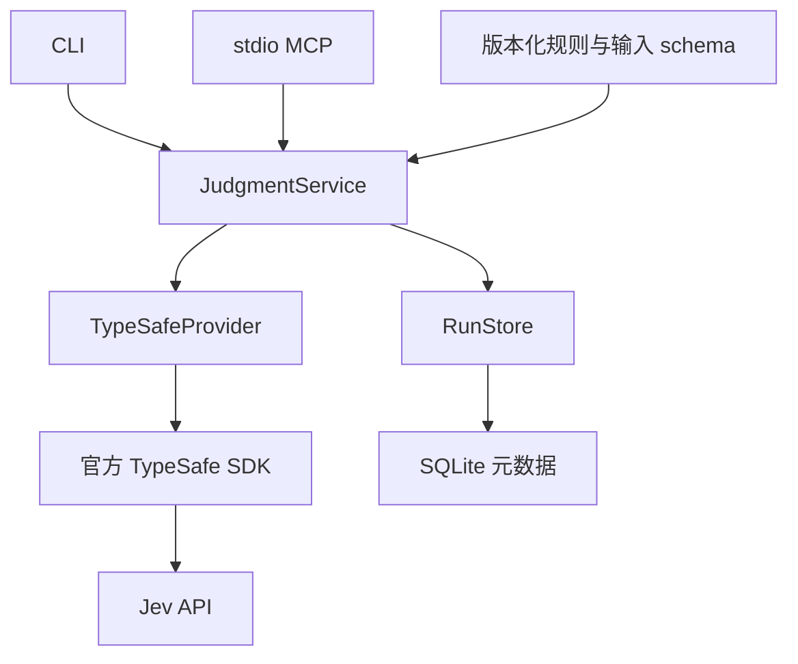

# 架构与边界

## 已采用的设计

共用执行内核、版本化规则、MCP/CLI 接入与 SQLite 元数据存储组成模块化单体。服务只接受显式提供的 JSON 材料，不自动获取仓库内容。

`plan()` 校验输入并生成确定的请求，不初始化 API 客户端或数据库。`run()` 使用同一 plan 调用 provider，再用规则映射结果并保存元数据。MCP 和 CLI 不各自实现判断逻辑。

评测模块读取显式标注集，使用同一 plan、响应校验与规则映射。默认只输出计划；外部预测通过固定响应评分，live 经同一执行服务。报告分开保留每项指标的分子/分母、unknown/review、失败计数以及请求/实际模型；模型与规则版本对比只接受同套件和同选定样本的报告。详见 [评测说明](evaluation.md)。

## 契约

规则输入严格校验、限制长度与候选数量；请求另有本地 1 MiB 上限。provider 的请求仅含 model/state/questions，使用官方 SDK。返回必须匹配问题 ID、primitive、选项和合法概率。Choice 与 Score 保留 confidence，Noul 只有 yes 的概率，不伪造 confidence。

排序使用 Score 的期望等级归一化到 0..1，代码稳定排序并保留全部候选。证据核对包含 insufficient，空证据不得接受；失败归类包含 unknown，建议不触发命令执行或重试。每条规则的版本、阈值与标准一起审查。

Score 校验先保留原有加权值差不超过 0.01 的路径（浮点 epsilon 为 1e-12）。超出时，仅对分数和所有概率均位于 0.01 网格的响应尝试本地 `rounded-2dp` 兼容策略：每个概率的舍入前区间为 `[max(0,p-0.005), min(1,p+0.005)]`，约束其和为 1，求加权值的最小/最大值，再检查与分数的 `±0.005` 区间是否相交。原有类型、范围、概率和与 legend 校验仍适用。没有可行分布或不符合精度条件时返回 INVALID_RESPONSE。

此策略未被官方精度契约确认。新增兼容回答保留上游分数、概率、confidence，附加本地 `consistency`（policy、requiresReview、reportedExpectation、minimumExpectation、maximumExpectation）。这些字段在每次校验时重新计算，不信任响应传入的注解。排序规则 1.1.0 对此强制 `requiresReview=true`、`reviewReason=score_rounding`；普通低置信使用 `low_confidence`，无需复核时为 null。原因优先展示舍入问题，原始 confidence 仍可判断是否同时低置信。阈值、rubric 与排序算法保持原值，其他规则仍为 1.0.0。

## 可靠性

SDK 负责单层重试，AbortSignal 管理整体评估预算；并发/排队由服务限制。响应错误、传输失败、鉴权失败、超时、存储失败分别映射为固定安全错误。上游成功后保存元数据失败会返回 STORAGE，不自动重新发起推理。

排队取消立即移除等待项并释放队列容量，未获得执行许可的请求不初始化 provider/store。获得许可后再次检查取消，包含依赖初始化失败在内的所有路径均释放许可。MCP 将协议取消信号传到执行服务和 SDK；已取消的结果不能记为成功。套件 live 顺序执行，显式预算覆盖样本数与最坏情况下的 SDK 重试。

当前进程中断可能使正在执行的请求没有完成记录；还未实现持久化的 running 状态、恢复或 exactly-once。调用者看到错误不能假定未产生 API 用量。

## 数据与范围

数据库保存规则/模型版本、用量、耗时、状态、安全错误码和请求标识。schema v2 增量增加 evaluation_reports 保存套件/评测器版本、数据摘要、请求/实际模型与分项指标；旧 runs/evaluations 保留，未补写原本不存在的维度。迁移在 BEGIN IMMEDIATE 锁内读取版本，失败回滚；多连接初始化由独立进程测试。评测原始材料、标签和完整预测仍留在外部文件。目前无结果缓存、token 预算估算或费用计算。输入与完整判断只在内存与调用输出中出现；调用者保存输出时自行控制范围。

首版的 SQLite 单机适配器面向一个本地工具进程，不作为共享服务数据库。暂不提供 HTTP 服务、鉴权系统、控制台、Git/浏览器适配器。扩展顺序见 CLOUD_TASK.md。
